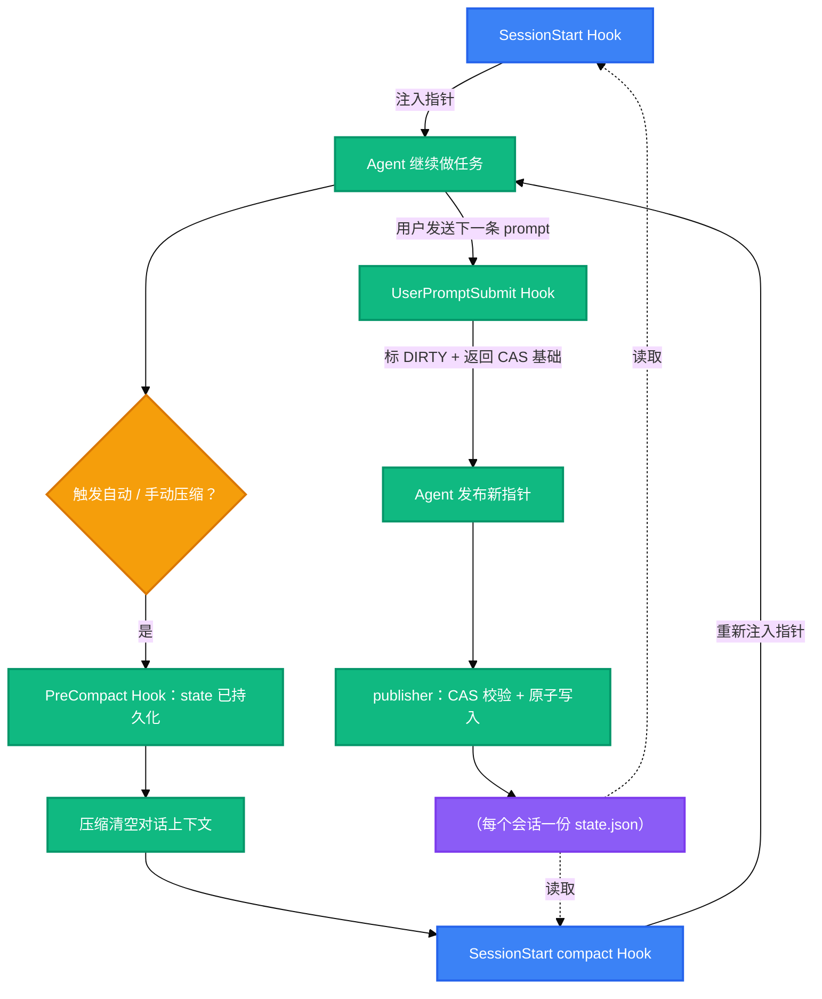

<h1 align="center">codex-task-pointer</h1>

<p align="center">
  <strong>让 Codex agent 在上下文自动压缩之后仍然盯住主线目标</strong>
  <br />
  <em>压缩前 Hook · CAS 任务指针 · Windows 安装器 · 可交给 agent 自行部署</em>
</p>

<p align="center">
  <a href="#快速开始"></a>
  <a href="LICENSE"></a>
</p>

<p align="center">
  
  
  
  
</p>

<p align="center">
  中文 · <a href="README.md">English</a>
</p>

## 功能特性

Codex 的中长任务总会撞上自动压缩：计划被压缩掉，模型或者漂到相邻目标上，或者把已完成的工作再做一遍。这个运行时把一份很小的、受 schema 约束的指针写进磁盘，并在恰好丢失上下文的事件点上把它重新注入。

- 🧭 **主线在压缩后存活** — Codex 自动或手动压缩时，`SessionStart(compact)` Hook 把"目标 + 下一步"重新注入新上下文，模型重新锚定，不再漂移。
- ♻️ **不重复已完成的工作** — 指针是 agent 自己显式发布的"目标 + 下一步"，压缩后的回合接着真实计划走，而不是重新猜一个。
- ⚛️ **CAS 保护的写入** — 每次发布都携带 `generation` + `revision`；过期写入直接失败（`STALE_GENERATION` / `STALE_REVISION`），清除会轮换 generation，旧请求无法复活旧状态。
- 🔒 **严格 IO，默认拒绝** — stdin JSON 仅接受严格 UTF-8、固定字段集合、拒绝重复字段；按 session 互斥，原子写入并读回校验。
- 🪟 **带回滚的 Windows 安装器** — `-WhatIf` 预览、owned 文件备份、原子合并 `hooks.json` 且保留你的其他 Hook、显式 `-Rollback`。
- 🤖 **直接交给 agent 部署** — [AGENTS.md](AGENTS.md) 是完整的部署 playbook：把仓库链接发给你的 agent，它能自主安装、验证和调试，只在真正需要人的地方询问你。

## 为什么写这个工具

Codex 跑长目标时总是悄悄坏掉：自动压缩把计划吞掉，下一个回合要么跑偏，要么把做完的事再做一遍——然后我再花一条 prompt 解释"我们现在在哪"。所以我做了这件能在"上下文丢失瞬间"存活下来的最小东西：一个受 schema 校验的指针文件，加三个在关键事件上重新注入它的根 Hook。从那以后，我自己的 Codex 长会话一直在用它。

## 效果对比

| 以前 | 用 codex-task-pointer |
|---|---|
| 每次自动压缩后：重新粘贴计划、重新解释当前步骤 | 指针（目标 + 下一步）自动重新注入新上下文 |
| 任务跑到一半漂到相邻目标上 | SessionStart 在下一个回合开始前恢复主线锚点 |
| 两个会话互相覆盖对方的进度记录 | generation + revision CAS：过期发布被拒绝，状态完好 |
| 手改 `hooks.json`，一个语法错误杀掉全部 Hook | 安装器原子合并、先备份、可干净回滚 |

用一周的深夜写完，全程 agent 协作。我自己的每个 Codex 长会话都在用它。一个坦白的缺点：完整 E2E 需要在真实 home 中信任 Hook 且模型认证可用，所以自动化验证止步于静态、核心和安装器门（`tests\run-all.ps1 -SkipAppServer`）。

## 快速开始

### 前置要求

- Windows + PowerShell 7.5+（`pwsh --version`）
- 已安装 Codex CLI（`codex --version`）
- Node.js 18+ 仅在运行可选探针 / E2E harness 时需要

### 克隆并自检

```powershell
git clone https://github.com/<owner>/codex-task-pointer.git
cd codex-task-pointer

pwsh -NoProfile -File .\tests\Test-TaskPointerLifecycle.ps1   # 期望 failed=0
pwsh -NoProfile -File .\tests\install-smoke.ps1               # 期望 PASS
```

### 预览后安装

```powershell
pwsh -NoProfile -File .\scripts\install.ps1 -CodexHome $env:CODEX_HOME -Apply -WhatIf
pwsh -NoProfile -File .\scripts\install.ps1 -CodexHome $env:CODEX_HOME -Apply -Confirm:$false
```

安装会把运行时复制到 `<CODEX_HOME>\task-pointer\`，并向 `<CODEX_HOME>\hooks.json` 合并三个事件。你的其他 Hook、`config.toml`、会话和 Memory 都不会被改动。

### 信任 Hook（唯一需要人做的一步）

打开 Codex，运行 `/hooks`，审阅并批准三条 task-pointer 命令。这是宿主的安全审阅——新 Hook 会被发现，但在人批准之前不会执行，也没有任何 CLI 或配置开关能绕过。

## 使用方法

### 发布指针（agent 在任务中调用的入口）

```powershell
'{
  "schema_version": 3,
  "session_id": "s-demo",
  "expected_generation": "g-0123456789abcdef0123456789abcdef",
  "expected_revision": 2,
  "task_id": "<UUID_V4>",
  "target_status": "CLEAN",
  "pointer_text": "目标：交付导入器\n下一步：跑夹具测试"
}' | pwsh -NoProfile -File .\src\task-pointer-publish.ps1 -SessionId s-demo
```

提交前把 `<UUID_V4>` 替换为真实的小写 UUID v4。`expected_generation` / `expected_revision` 是上一次 Hook 上下文返回的 CAS 基础；不匹配返回 `STALE_GENERATION` 或 `STALE_REVISION`，退出码 2，state 保持不变。完整字段规则见 [docs/protocol.md](docs/protocol.md)。

### 只读验证发现

```powershell
node .\tests\app-server-hooks-list.mjs --cwd . --codex-home $env:CODEX_HOME --output $env:TEMP\hooks-list.json
```

期望 `verdict: PASS`、`target_count: 3`、错误和警告为 0。在 `/hooks` 批准之后可追加 `--require-trusted` 复验。

### 迁移 v1 记录

```powershell
pwsh -NoProfile -File .\scripts\migrate-v1-to-v3.ps1 -V1Root <旧记录根> -V2Root <状态根>            # 只读预览
pwsh -NoProfile -File .\scripts\migrate-v1-to-v3.ps1 -V1Root <旧记录根> -V2Root <状态根> -Apply   # 写入
```

### 回滚安装

```powershell
pwsh -NoProfile -File .\scripts\install.ps1 -CodexHome $env:CODEX_HOME -Rollback -BackupPath <安装收据中的 backup>
```

## 架构



| Hook 事件 | 触发时机 | 行为 |
|---|---|---|
| `SessionStart` | startup / resume / clear / compact | `clear` 写入 CLEARED fence；其余来源把当前指针（≤ 10 KB）作为附加上下文注入 |
| `UserPromptSubmit` | 每条 prompt | 把可继续的指针标为 DIRTY，并返回下一次发布所需的 generation/revision |
| `PreCompact` | 手动或自动压缩 | 只读观察点——指针在 publish/prompt 时已持久化 |

线上格式、CAS 规则与错误码：[docs/protocol.md](docs/protocol.md)。安全边界：[docs/security.md](docs/security.md)。

## 配置

### 安装器参数

| 参数 | 用途 |
|---|---|
| `-CodexHome <path>` | 目标 home；默认取 `$env:CODEX_HOME`，其次 `~\.codex` |
| `-Apply` / `-WhatIf` | 应用安装 / 只打印计划不写入 |
| `-Rollback -BackupPath <path>` | 从安装备份恢复 owned 文件与 Hook 条目 |

### 安装器 own 的路径

| 路径 | 内容 |
|---|---|
| `<CODEX_HOME>\task-pointer\` | 运行时脚本、schema、Hook 示例 |
| `<CODEX_HOME>\hooks.json` | 合并后的三个 Hook 事件（其他 Hook 保留） |
| `<CODEX_HOME>\task-pointer-install-backups\` | 每次安装的备份 manifest |
| `<CODEX_HOME>\state\task-pointers\v2\` | 每个会话一份 `state.json`，按 `s-<hex>` 编码 |

## 项目结构

```
codex-task-pointer/
├── AGENTS.md                      # 面向用户 agent 的部署 playbook
├── src/
│   ├── task-pointer-store.ps1     # 路径、schema 校验、互斥、原子写、CAS
│   ├── task-pointer-lifecycle.ps1 # Hook stdin 事件 -> state 变更 / 恢复上下文
│   └── task-pointer-publish.ps1   # stdin JSON 请求 -> CAS 发布
├── hooks/
│   └── hooks.example.json         # 可移植 Hook 定义模板
├── schemas/                       # state-v3 + publish-request-v3 JSON Schema
├── scripts/
│   ├── install.ps1                # 预览 / 应用 / 回滚安装器
│   ├── migrate-v1-to-v3.ps1       # v1 记录 -> state v3（默认只读预览）
│   └── validate-public-tree.ps1   # 脱敏门：allowlist、敏感信息、链接
├── tests/                         # 35 用例生命周期套件、安装 smoke、app-server harness
├── docs/                          # 架构 / 协议 / 安装 / 迁移 / 安全
└── .github/                       # issue 与 PR 模板
```

## 技术栈

| 层 | 选择 |
|---|---|
| 运行时 | PowerShell 7.5+，无第三方模块 |
| 协议 | JSON Schema（state v3、publish request v3）、严格 UTF-8、固定字段集合 |
| 并发 | 按 session 命名互斥、generation + revision CAS、原子文件替换 |
| 测试 | PowerShell 生命周期套件、安装 smoke、Node.js 18+ app-server E2E harness |

## 贡献

1. Fork 仓库
2. 创建功能分支（`git checkout -b feature/short-name`）
3. 跑门禁：`pwsh -NoProfile -File .\tests\run-all.ps1 -SkipAppServer` 与 `pwsh -NoProfile -File .\scripts\validate-public-tree.ps1`
4. 提交 Pull Request 并附上收据输出

保持公开树脱敏：提交中不出现个人路径、凭据、会话数据和指针正文。

## 许可证

[MIT](LICENSE)
