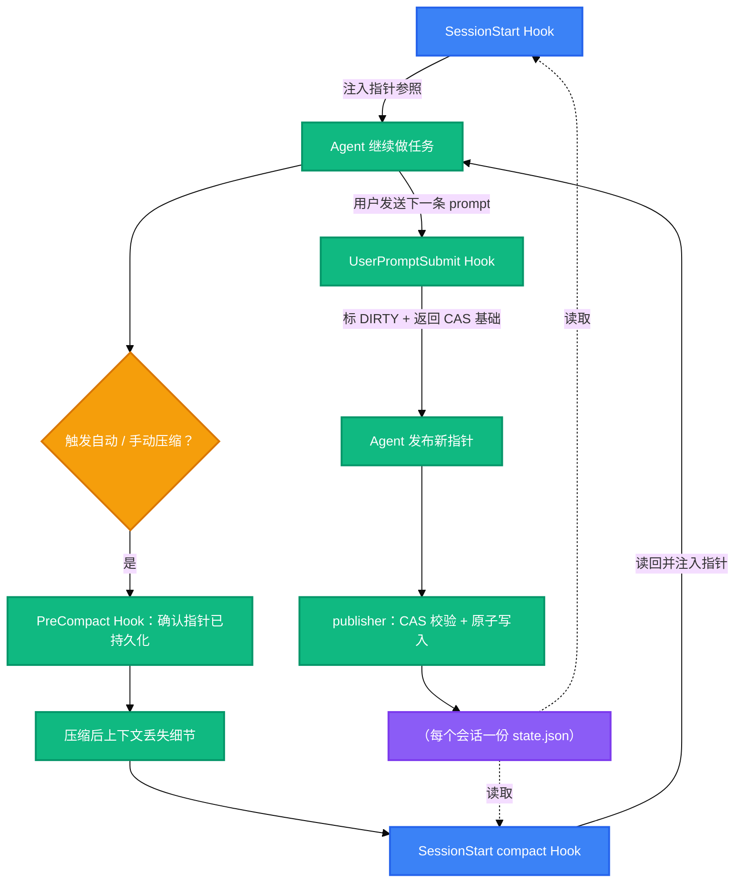

<h1 align="center">codex-task-pointer</h1>

<p align="center">
  <strong>让 Codex agent 在上下文自动压缩之后仍然盯住主线目标</strong>
  <br />
  <em>压缩前 Hook · CAS 任务指针 · Windows 安装器 · 可 agent 自行部署</em>
</p>

<p align="center">
  <a href="https://github.com/openai/codex"></a>
  
  
  <a href="LICENSE"></a>
</p>

<p align="center">
  中文 · <a href="README.md">English</a>
</p>

## 功能特性

Codex 在中长任务或长时间 goal 执行中，自动压缩上下文可能导致：关键节点被压缩掉、目标漂移、重复已完成的工作、与已完成的工作发生冲突。本仓库通过 Hook 维护一份很小的、受 schema 约束的任务指针：agent 发布指针与用户提交 prompt 时即持久化到磁盘；压缩发生时 Hook 确认其完好，压缩完成后由 SessionStart 把它重新注入，作为压缩后的参照背景，使压缩导致的信息丢失不再演变为漂移和返工。

- 🧭 **主线在压缩后存活** — Codex 自动或手动压缩时，`SessionStart(compact)` Hook 把"目标 + 下一步"重新注入新上下文，模型重新锚定，避免漂移。
- ♻️ **不重复已完成的工作** — 指针是 agent 自己显式发布的"目标 + 下一步"，压缩后的回合接着真实计划走，而不是在失真节点继续。
- ⚛️ **CAS 保护的写入** — 每次发布都携带 `generation` + `revision`；过期写入直接失败（`STALE_GENERATION` / `STALE_REVISION`），清除会轮换 generation，旧请求无法复活旧状态。
- 🔒 **严格 IO，默认拒绝** — stdin JSON 仅接受严格 UTF-8、固定字段集合、拒绝重复字段；按 session 互斥，原子写入并读回校验。
- 🪟 **带回滚的 Windows 安装器** — `-WhatIf` 预览、owned 文件备份、原子合并 `hooks.json` 且保留你的其他 Hook、显式 `-Rollback`。
- 🤖 **交给 agent 部署** — [AGENTS.md](AGENTS.md) 是完整的部署 playbook：把仓库链接发给你的 agent，它能自主安装、验证和调试，只在真正需要人的地方询问你。

## 为什么写这个工具

Codex 跑长目标时总是悄悄坏掉：自动压缩把计划吞掉，下一个回合要么跑偏，要么把做完的事再做一遍——然后我再花一条 prompt 解释"我们现在在哪"，同时损失 token 和时间。所以我做了这件能在"自动压缩上下文导致信息丢失中"存活下来的最小东西：一个受 schema 校验的指针文件，加三个在关键事件上重新注入它的根 Hook。从那以后，我自己的 Codex 会话一直在用它，帮我避免了很多麻烦。

我用了 1 个月左右、使用 gpt-5.6-sol 模型花费约 30 亿 token，全程 Codex 协作反复调试，才凝练出这个小东西。我自己的每个 Codex 会话都在用它。

## 效果对比

| 以前 | 用 codex-task-pointer |
|---|---|
| 自动压缩后：重新粘贴计划、重新解释当前步骤、纠正执行节点 | 指针（目标 + 下一步）自动重新注入新上下文 |
| 任务跑到一半漂到未知目标上 | SessionStart 在下一个回合开始前恢复主线锚点 |
| 手改 `hooks.json`，一个语法错误杀掉全部 Hook | 安装器原子合并、先备份、可干净回滚 |

## 快速开始

### 前置要求

- Windows + PowerShell **7.5+**（`pwsh --version`）——JSON 解析使用 `ConvertFrom-Json -DateKind`（7.5 起提供的参数），保证 ISO 日期字符串保持为字符串、不被自动转成日期对象
- 已安装 Codex CLI（`codex --version`）
- Node.js 18+ 仅在运行可选探针 / E2E harness 时需要

### 方式一：交给你的 agent（推荐）

把下面这段话直接发给你自己的 Codex：

```text
请阅读仓库中的 AGENTS.md，
按其部署手册把 Task Pointer 安装并配置到我的 CODEX_HOME；
先完成仓库自检和安装预览，只在必须由人完成的步骤（如在 /hooks 中信任 Hook）时提示我。
```

agent 会自主完成 clone、自检、安装预览和应用，并在最后提示你在宿主中信任 Hook；它不会改动 `config.toml`、凭据、会话和 Memory。

### 方式二：手动安装

克隆仓库并自检（测试只写系统临时目录，不影响本机配置）：

```powershell
git clone https://github.com/<owner>/codex-task-pointer.git
cd codex-task-pointer

pwsh -NoProfile -File .\tests\Test-TaskPointerLifecycle.ps1   # 期望 failed=0
pwsh -NoProfile -File .\tests\install-smoke.ps1               # 期望 PASS
```

先预览再安装：`-WhatIf` 只打印计划不写入；`-Apply` 把运行时复制到 `<CODEX_HOME>\task-pointer\`，并向 `<CODEX_HOME>\hooks.json` 原子合并三个事件——你的其他 Hook、`config.toml`、会话和 Memory 都不会被改动。

```powershell
pwsh -NoProfile -File .\scripts\install.ps1 -CodexHome $env:CODEX_HOME -Apply -WhatIf
pwsh -NoProfile -File .\scripts\install.ps1 -CodexHome $env:CODEX_HOME -Apply -Confirm:$false
```

### 信任 Hook（唯一需要你亲自做的一步）

打开 Codex，运行 `/hooks`，审阅并批准三条 task-pointer 命令。这是宿主的安全审阅——新 Hook 会被发现，但在人批准之前不会执行，也没有任何 CLI 或配置开关能绕过。

完整 E2E 需要在你的 Codex CLI 中先信任 Hook，且模型认证可用，所以安装时的自动化验证止步于静态、核心和安装器门（`tests\run-all.ps1 -SkipAppServer`）。

## 使用方法

安装并信任 Hook 之后，日常使用是完全无感的：Hook 在你提交消息和压缩发生时自动维护任务指针，压缩完成后自动把指针注入新上下文，你不需要执行任何命令。你能感知到的只有两处——会话启动时的 "Restoring task pointer" 状态提示，以及压缩后上下文中的指针参照（agent 会据此确认目标与下一步再继续）。

### 排障与维护

只读探针：确认 Hook 被宿主发现且无诊断；在 `/hooks` 批准之后可追加 `--require-trusted` 复验信任状态。

```powershell
node .\tests\app-server-hooks-list.mjs --cwd . --codex-home $env:CODEX_HOME --output $env:TEMP\hooks-list.json
```

期望 `verdict: PASS`、`target_count: 3`、错误和警告为 0。

回滚安装：使用安装收据中记录的 backup 路径，只恢复安装器 own 的文件与 Hook 条目，不触碰你的其他配置。

```powershell
pwsh -NoProfile -File .\scripts\install.ps1 -CodexHome $env:CODEX_HOME -Rollback -BackupPath <安装收据中的 backup>
```

## 架构及原理

### 运行机制

任务指针的持久化发生在任务执行过程中，而不是压缩发生时：

- **agent 发布指针** — agent 在任务推进中把"目标 + 下一步"通过 publisher 以 CAS 方式写入磁盘上的 `state.json`（每个会话一份）；
- **UserPromptSubmit**（每条 prompt 触发）— 把可继续的指针标为 DIRTY，并把下一次发布所需的 generation/revision 与发布契约注入上下文；
- **PreCompact**（自动或手动压缩发生时触发）— 只读观察点：此时指针早已落盘，Hook 只确认其完好，不复制、不改写；
- **SessionStart(compact / startup / resume)** — 压缩或新会话开始后，Hook 从磁盘读回指针，作为附加上下文**叠加**到新上下文（不覆盖压缩摘要），模型据此确认"我们在哪、下一步是什么"再继续——CLEAN 直接继续，DIRTY 先合并。

### 流程图



### 三个 Hook 事件

| Hook 事件 | 触发时机 | 行为 |
|---|---|---|
| `SessionStart` | startup / resume / clear / compact | `clear` 写入 CLEARED fence；其余来源把当前指针（≤ 10 KB）作为附加上下文注入 |
| `UserPromptSubmit` | 每条 prompt | 把可继续的指针标为 DIRTY，并返回下一次发布所需的 generation/revision |
| `PreCompact` | 手动或自动压缩 | 只读观察点——指针在 publish/prompt 时已持久化 |

### agent 协议

Hook 注入的上下文包含 publisher 路径、请求 schema 和当前 CAS 基础，`task_id`（UUID）由 agent 每次发布时自行生成。发布请求形如：

```json
{
  "schema_version": 3,
  "session_id": "s-demo",
  "expected_generation": "g-0123456789abcdef0123456789abcdef",
  "expected_revision": 2,
  "task_id": "<UUID_V4>",
  "target_status": "CLEAN",
  "pointer_text": "目标：交付导入器\n下一步：跑夹具测试"
}
```

CAS 规则：`expected_generation` / `expected_revision` 与磁盘状态不一致时返回 `STALE_GENERATION` / `STALE_REVISION`（退出码 2，state 保持不变）；清除指针会轮换 generation，旧请求无法复活旧状态。

完整字段规则见 [docs/protocol.md](docs/protocol.md)；安全边界见 [docs/security.md](docs/security.md)；磁盘上存在旧版本（v1）记录时，先用[迁移器](docs/migration.md)做只读预览，确认后再显式 `-Apply`。

## 配置

### 安装器参数

| 参数 | 用途 |
|---|---|
| `-CodexHome <path>` | 目标 home；默认取 `$env:CODEX_HOME`，其次 `~\.codex` |
| `-Apply` / `-WhatIf` | 应用安装 / 只打印计划不写入 |
| `-Rollback -BackupPath <path>` | 从安装备份恢复 owned 文件与 Hook 条目 |

### 安装器 own 的路径

| 路径 | 内容 |
|---|---|
| `<CODEX_HOME>\task-pointer\` | 运行时脚本、schema、Hook 示例 |
| `<CODEX_HOME>\hooks.json` | 合并后的三个 Hook 事件（其他 Hook 保留） |
| `<CODEX_HOME>\task-pointer-install-backups\` | 每次安装的备份 manifest |
| `<CODEX_HOME>\state\task-pointers\v2\` | 每个会话一份 `state.json`，按 `s-<hex>` 编码 |

## 项目结构

```
codex-task-pointer/
├── AGENTS.md                      # 面向用户 agent 的部署 playbook
├── src/
│   ├── task-pointer-store.ps1     # 路径、schema 校验、互斥、原子写、CAS
│   ├── task-pointer-lifecycle.ps1 # Hook stdin 事件 -> state 变更 / 恢复上下文
│   └── task-pointer-publish.ps1   # stdin JSON 请求 -> CAS 发布
├── hooks/
│   └── hooks.example.json         # 可移植 Hook 定义模板
├── schemas/                       # state-v3 + publish-request-v3 JSON Schema
├── scripts/
│   ├── install.ps1                # 预览 / 应用 / 回滚安装器
│   ├── migrate-v1-to-v3.ps1       # v1 记录 -> state v3（默认只读预览）
│   └── validate-public-tree.ps1   # 脱敏门：allowlist、敏感信息、链接
├── tests/                         # 35 用例生命周期套件、安装 smoke、app-server harness
├── docs/                          # 架构 / 协议 / 安装 / 迁移 / 安全
└── .github/                       # issue 与 PR 模板
```

## 技术栈

| 层 | 选择 |
|---|---|
| 运行时 | PowerShell 7.5+，无第三方模块 |
| 协议 | JSON Schema（state v3、publish request v3）、严格 UTF-8、固定字段集合 |
| 并发 | 按 session 命名互斥、generation + revision CAS、原子文件替换 |
| 测试 | PowerShell 生命周期套件、安装 smoke、Node.js 18+ app-server E2E harness |

## 贡献

1. Fork 仓库
2. 创建功能分支（`git checkout -b feature/short-name`）
3. 跑门禁：`pwsh -NoProfile -File .\tests\run-all.ps1 -SkipAppServer` 与 `pwsh -NoProfile -File .\scripts\validate-public-tree.ps1`
4. 提交 Pull Request 并附上收据输出

保持公开树脱敏：提交中不出现个人路径、凭据、会话数据和指针正文。

## 许可证

[MIT](LICENSE)
