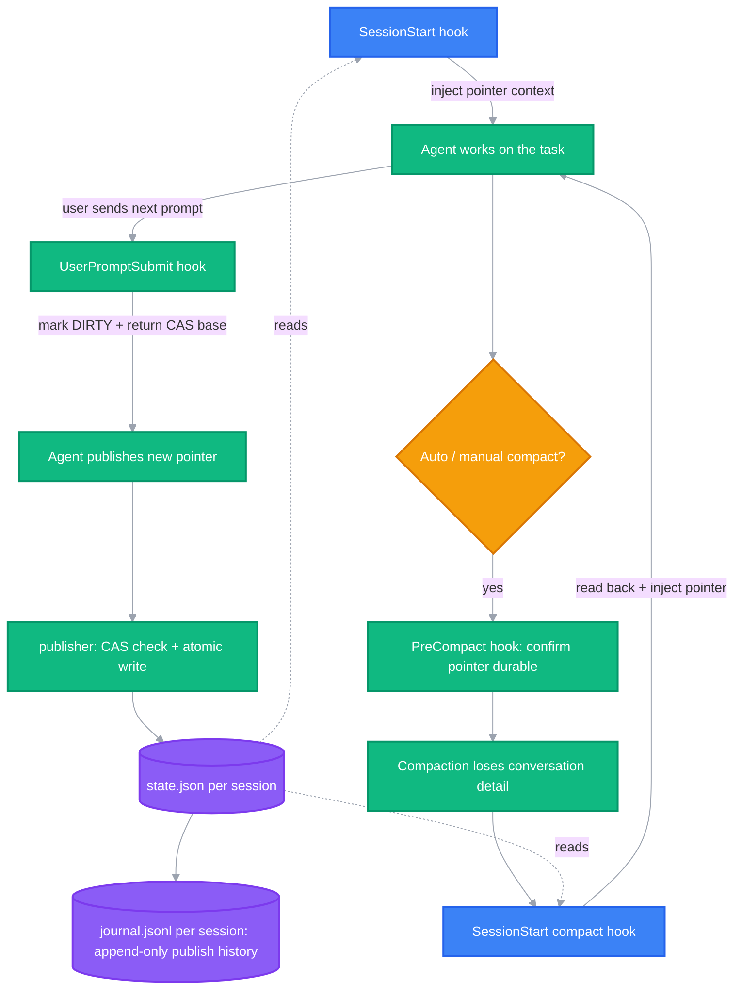

<h1 align="center">codex-task-pointer</h1>

<p align="center">
  <strong>Keep your Codex agent on-goal across context auto-compaction</strong>
  <br />
  <em>Pre-compaction hooks · CAS task pointer · Windows installer · agent-deployable</em>
</p>

<p align="center">
  <a href="https://github.com/openai/codex"></a>
  
  
  <a href="LICENSE"></a>
</p>

<p align="center">
  English · <a href="README-zh.md">中文</a>
</p>

## Features

On mid-length tasks and long goal runs, Codex auto-compaction can wipe key milestones, drift the objective, redo finished work, or collide with it. This repo maintains a small, schema-checked task pointer through hooks: the pointer is persisted to disk when the agent publishes it and when you submit a prompt; when compaction fires, a hook confirms it is intact, and after compaction SessionStart re-injects it as the post-compaction reference background — so information loss stops turning into drift and rework.

- 🧭 **Mainline survives compaction** — when Codex compacts (auto or manual), the `SessionStart(compact)` hook re-injects your "goal + next step" into the fresh context, so the model re-anchors instead of drifting.
- ♻️ **No redoing finished work** — the pointer is an explicit "goal + next step" your agent publishes itself, so the post-compaction turn follows the real plan instead of continuing from a distorted node.
- ⚛️ **CAS-guarded writes** — every publish carries `generation` + `revision`. Stale writes fail loudly (`STALE_GENERATION` / `STALE_REVISION`), and clearing rotates the generation so an old request can't resurrect state.
- ⏱️ **Staleness and standstill are visible** — every `UserPromptSubmit` injects `POINTER_AGE_SECONDS`, `JOURNAL_IDENTICAL_TEXT_STREAK` and a `NEXT_ACTION` hint, so "how old is this pointer" and "is the agent republishing the same text" are in context. When nothing changed the hook does not rewrite `state.json` or bump `revision`, so the age reflects the last real content change.
- 📜 **Append-only publish journal** — each publish and clear appends one metadata-only record (plus SHA-256) to `journal.jsonl` next to the state file; pointer text is never written to the journal. So "when was the pointer cleared, and which one was it" stays answerable. The journal is an audit sidecar: a failed append never blocks a publish, and the receipt reports `journal_appended=false`.
- 🔎 **Read-only diagnostics** — [`src/task-pointer-report.ps1`](src/task-pointer-report.ps1) prints status, `revision`, pointer age, journal depth and the last ten publish records at any time; `-Recall` looks up a historical revision.
- 🔒 **Strict IO, fail closed** — UTF-8-only stdin JSON, fixed field sets, duplicate-key rejection, per-session mutex, atomic write with read-back verification.
- 🪟 **Windows installer with a rollback path** — `-WhatIf` preview, owned-file backup, atomic `hooks.json` merge that preserves your other hooks, explicit `-Rollback`.
- 🤖 **Delegate deployment to your agent** — [AGENTS.md](AGENTS.md) is a complete deployment playbook: send your agent the repo link and it installs, verifies and debugs on its own, asking you only where a human is actually required.

## Why I Built This

Long Codex goal runs kept dying quietly: auto-compaction swallowed the plan, the next turn either drifted sideways or redid work that was already done — and I burned another prompt re-explaining where we were, losing tokens and time. So I built the smallest thing that survives "auto-compaction information loss": a schema-checked pointer file plus three root hooks that re-inject it at the right events. It has been running in my own Codex sessions ever since, and has saved me a lot of trouble.

It took me about a month and roughly 3 billion tokens on gpt-5.6-sol, iterating with Codex the whole way, to distill this little thing. I use it in every Codex session I run.

## Impact

| Before | With codex-task-pointer |
|---|---|
| After every auto-compact: re-paste the plan, re-explain the current step, correct the execution node | The pointer (goal + next step) is re-injected into the fresh context automatically |
| The run drifts onto an unknown goal halfway through | SessionStart restores the mainline anchor before the next turn starts |
| Hand-editing `hooks.json`, one syntax slip kills every hook | The installer merges atomically, backs up first, and rolls back cleanly |

## Quick Start

### Prerequisites

- Windows with PowerShell **7.5+** (`pwsh --version`) — the JSON layer uses `ConvertFrom-Json -DateKind`, a parameter added in 7.5, so ISO date strings are kept as strings instead of being auto-converted
- Codex CLI installed (`codex --version`)
- Node.js 18+ only for the optional probe / E2E harness

### Path 1: delegate to your agent (recommended)

Paste this directly to your own Codex:

```text
Please read the AGENTS.md in the codex-task-pointer repository and follow its
deployment playbook to install and configure Task Pointer into my CODEX_HOME;
run the repo self-check and an install preview first, and only prompt me for
steps that genuinely require a human (such as trusting the hooks in /hooks).
```

The agent performs clone, self-check, install preview and apply on its own, and only surfaces the host trust step at the end; it does not touch `config.toml`, credentials, sessions or Memory.

### Path 2: manual install

Clone and self-check (the tests only write to the system temp directory):

```powershell
git clone https://github.com/big0lives/codex-task-pointer.git
cd codex-task-pointer

pwsh -NoProfile -File .\tests\Test-TaskPointerLifecycle.ps1   # expect failed=0
pwsh -NoProfile -File .\tests\install-smoke.ps1               # expect PASS
```

Preview, then apply: `-WhatIf` prints the plan without writing; `-Apply` copies the runtime to `<CODEX_HOME>\task-pointer\` and atomically merges three events into `<CODEX_HOME>\hooks.json` — your other hooks, `config.toml`, sessions and Memory are not touched.

```powershell
pwsh -NoProfile -File .\scripts\install.ps1 -CodexHome $env:CODEX_HOME -Apply -WhatIf
pwsh -NoProfile -File .\scripts\install.ps1 -CodexHome $env:CODEX_HOME -Apply -Confirm:$false
```

### Trust the hooks (the one human step)

Open Codex, run `/hooks`, and approve the three task-pointer commands. This is the host's security review — new hooks are discovered but stay inert until a human approves them, and no CLI or config switch bypasses that.

The full E2E additionally requires hooks trusted in your Codex CLI home and usable model auth, so automated verification at install time stops at the static, core and installer gates (`tests\run-all.ps1 -SkipAppServer`).

## Usage

Once installed and trusted, day-to-day use is completely hands-off: hooks maintain the task pointer when you submit prompts and when compaction fires, and the pointer is injected into the fresh context automatically — you never run a command. The only things you will ever perceive are the "Restoring task pointer" status at session start and the pointer reference in post-compaction context (your agent confirms the goal and next step against it before continuing).

### Troubleshooting & maintenance

Read-only probe: confirm the hooks are discovered by the host with no diagnostics; after approving them in `/hooks`, append `--require-trusted` to re-verify trust.

```powershell
node .\tests\app-server-hooks-list.mjs --cwd . --codex-home $env:CODEX_HOME --output $env:TEMP\hooks-list.json
```

Expect `verdict: PASS`, `target_count: 3`, zero errors and warnings.

Roll back an install: use the `backup` path recorded in the install receipt; only installer-owned files and hook entries are restored, your other configuration is untouched.

```powershell
pwsh -NoProfile -File .\scripts\install.ps1 -CodexHome $env:CODEX_HOME -Rollback -BackupPath <backup-from-install-receipt>
```

## Architecture & Principles

### How it works

The pointer is persisted during task execution, not at compaction time:

- **Agent publishes the pointer** — as a task progresses, the agent writes "goal + next step" through the publisher with CAS into `state.json` on disk (one per session);
- **UserPromptSubmit** (every prompt) — marks a continuable pointer DIRTY and injects the generation/revision plus the publish contract for the next publish into context;
- **PreCompact** (auto or manual compaction) — read-only observation point: the pointer is already on disk; the hook only confirms it is intact, never copies or rewrites it;
- **SessionStart (compact / startup / resume)** — after compaction or on a new session, the hook reads the pointer back from disk and **appends** it to the fresh context (it never overwrites the compaction summary); the model confirms "where we are, what's next" and continues — CLEAN continues directly, DIRTY merges first.

### Flow



### The three hook events

| Hook event | Fires on | What it does |
|---|---|---|
| `SessionStart` | startup / resume / clear / compact | `clear` writes a CLEARED fence; other sources inject the current pointer (≤ 10 KB) as additional context |
| `UserPromptSubmit` | every prompt | marks a continuable pointer DIRTY and returns the generation/revision base for the next publish |
| `PreCompact` | manual or auto compaction | read-only observation point — the pointer was already persisted at publish/prompt time |

### Agent protocol (handled automatically — humans don't need this)

The hook-injected context contains the publisher path, the request schema and the current CAS base; `task_id` (a UUID) is generated by the agent on every publish. A publish request looks like:

```json
{
  "schema_version": 3,
  "session_id": "s-demo",
  "expected_generation": "g-0123456789abcdef0123456789abcdef",
  "expected_revision": 2,
  "task_id": "<UUID_V4>",
  "target_status": "CLEAN",
  "pointer_text": "Goal: ship the importer\nNext: run the fixture suite"
}
```

CAS rules: a `expected_generation` / `expected_revision` mismatch with the on-disk state returns `STALE_GENERATION` / `STALE_REVISION` (exit code 2, state untouched); clearing rotates the generation so stale requests cannot resurrect old state.

Full field rules: [docs/protocol.md](docs/protocol.md). Security boundaries: [docs/security.md](docs/security.md). Design rationale, the borrowings from other context tools and the explicit non-goals: [docs/design.md](docs/design.md). If old-version (v1) records exist on disk, preview them with the [migrator](docs/migration.md) first and only then apply with `-Apply`.

## Configuration

### Installer parameters

| Parameter | Purpose |
|---|---|
| `-CodexHome <path>` | target home; defaults to `$env:CODEX_HOME`, then `~\.codex` |
| `-Apply` / `-WhatIf` | apply the install / print the plan without writing |
| `-Rollback -BackupPath <path>` | restore the owned files and hook entries from an install backup |

### Paths the installer owns

| Path | Content |
|---|---|
| `<CODEX_HOME>\task-pointer\` | runtime scripts, schemas, hook example |
| `<CODEX_HOME>\hooks.json` | the three merged hook events (your other hooks are preserved) |
| `<CODEX_HOME>\task-pointer-install-backups\` | per-install backup manifests |
| `<CODEX_HOME>\state\task-pointers\v2\` | one `state.json` per session, `s-<hex>` keyed |

## Project Structure

```
codex-task-pointer/
├── AGENTS.md                     # deployment playbook for user agents
├── src/
│   ├── task-pointer-store.ps1    # paths, schema checks, mutex, atomic writes, CAS, journal
│   ├── task-pointer-lifecycle.ps1# hook stdin events -> state changes / context
│   ├── task-pointer-publish.ps1  # stdin JSON request -> CAS publish
│   └── task-pointer-report.ps1   # read-only status / journal report (-Recall for history)
├── hooks/
│   └── hooks.example.json        # portable hook definition template
├── schemas/                      # state-v3 + publish-request-v3 JSON Schema
├── scripts/
│   ├── install.ps1               # preview / apply / rollback installer
│   ├── migrate-v1-to-v3.ps1      # v1 records -> state v3 (dry run by default)
│   └── validate-public-tree.ps1  # sanitization gate: allowlist, secrets, links
├── tests/                        # 48-case lifecycle suite, install smoke, app-server harnesses
├── docs/                         # architecture / protocol / design / install / migration / security
└── .github/                      # issue and PR templates, CI workflow (Windows + pwsh gates)
```

## Tech Stack

| Layer | Choice |
|---|---|
| Runtime | PowerShell 7.5+, no third-party modules |
| Protocol | JSON Schema (state v3, publish request v3), strict UTF-8, fixed field sets |
| Concurrency | per-session named mutex, generation + revision CAS, atomic file replace |
| Testing | PowerShell lifecycle suite, install smoke, Node.js 18+ app-server E2E harness |

## Contributing

1. Fork the repository
2. Create a feature branch (`git checkout -b feature/short-name`)
3. Run the gates: `pwsh -NoProfile -File .\tests\run-all.ps1 -SkipAppServer` and `pwsh -NoProfile -File .\scripts\validate-public-tree.ps1`
4. Open a Pull Request with the receipt outputs attached

CI runs the same gates on `windows-latest` for every pull request (see `.github/workflows/ci.yml`), so a green local run is what the check will report.

Workflow details: [CONTRIBUTING.md](CONTRIBUTING.md). Security reports go through the private channel in [SECURITY.md](SECURITY.md) — never a public issue.

Keep the tree sanitization-clean: no personal paths, credentials, session data or pointer contents in commits.

## Roadmap

- Evaluate a non-Windows (macOS / Linux) install path — the publisher request already carries a portable `command` field
- Hook trust flow documentation for the Codex desktop app
- Optional integrity manifest for the append-only journal (currently metadata-only by design)

## License

[MIT](LICENSE)

Maintained by [@big0lives](https://github.com/big0lives)
