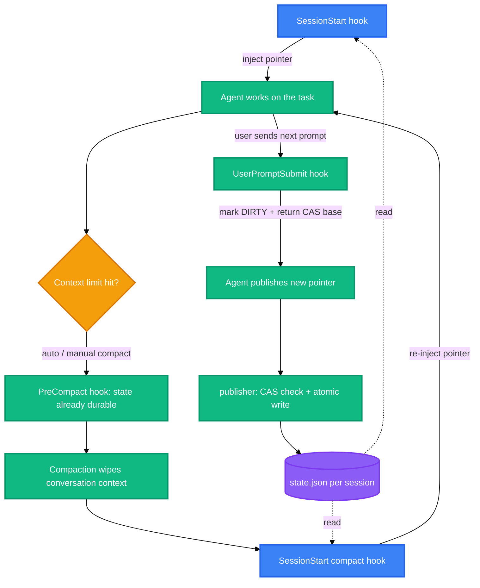

<h1 align="center">codex-task-pointer</h1>

<p align="center">
  <strong>Keep your Codex agent on-goal across context auto-compaction</strong>
  <br />
  <em>Pre-compaction hooks · CAS-guarded task pointer · Windows installer · agent-deployable</em>
</p>

<p align="center">
  <a href="#quick-start"></a>
  <a href="LICENSE"></a>
</p>

<p align="center">
  
  
  
  
</p>

<p align="center">
  <a href="README-zh.md">中文</a> · English
</p>

## Features

Long Codex runs hit auto-compaction, the plan gets swallowed, and the model drifts to a neighboring goal or redoes finished work. This runtime puts a small, schema-checked pointer on disk and re-injects it at exactly the events where context is lost.

- 🧭 **Mainline survives compaction** — when Codex compacts (auto or manual), a `SessionStart(compact)` hook re-injects your goal + next step into the fresh context. The model re-anchors instead of wandering off.
- ♻️ **No redoing finished work** — the pointer is an explicit "goal + next step" your agent publishes itself, so the post-compaction turn resumes the real plan instead of re-deriving one.
- ⚛️ **CAS-guarded writes** — every publish carries `generation` + `revision`. Stale writes fail loudly (`STALE_GENERATION` / `STALE_REVISION`), and clearing rotates the generation so an old request can't resurrect state.
- 🔒 **Strict IO, fail closed** — UTF-8-only stdin JSON, fixed field sets, duplicate-key rejection, per-session mutex, atomic write with read-back verification.
- 🪟 **Windows installer with a rollback path** — `-WhatIf` preview, owned-file backup, atomic `hooks.json` merge that preserves your other hooks, explicit `-Rollback`.
- 🤖 **Hand it to your agent** — [AGENTS.md](AGENTS.md) is a complete deployment playbook: send your agent the repo link and it installs, verifies and debugs on its own, asking you only where a human is actually required.

## Why I Built This

Long Codex goal runs kept dying quietly: auto-compaction would swallow the plan, and the next turn either drifted sideways or redid steps that were already done — then I burned another prompt re-explaining where we were. So I built the smallest thing that survives the exact moment context is lost: a schema-checked pointer file plus three root hooks that re-inject it. It has been running in my own Codex setup on every long session since.

## Impact

| Before | With codex-task-pointer |
|---|---|
| After every auto-compact: re-paste the plan and re-explain the current step | The pointer (goal + next step) is re-injected into the fresh context automatically |
| Agent wanders to a neighboring goal mid-run | SessionStart restores the mainline anchor before the next turn starts |
| Two sessions overwrite each other's progress notes | generation + revision CAS: the stale publish is rejected and state stays intact |
| Hand-editing `hooks.json`, one syntax slip kills every hook | The installer merges atomically, backs up first, and rolls back cleanly |

Built over a week of late nights, agent-assisted end to end. I run it on every long Codex session. One honest flaw: the full E2E needs hooks trusted inside a real home plus live model auth, so automated verification stops at the static, core and installer gates (`tests\run-all.ps1 -SkipAppServer`).

## Quick Start

### Prerequisites

- Windows with PowerShell 7.5+ (`pwsh --version`)
- Codex CLI installed (`codex --version`)
- Node.js 18+ only for the optional probe / E2E harness

### Clone and self-check

```powershell
git clone https://github.com/<owner>/codex-task-pointer.git
cd codex-task-pointer

pwsh -NoProfile -File .\tests\Test-TaskPointerLifecycle.ps1   # expect failed=0
pwsh -NoProfile -File .\tests\install-smoke.ps1               # expect PASS
```

### Preview, then install

```powershell
pwsh -NoProfile -File .\scripts\install.ps1 -CodexHome $env:CODEX_HOME -Apply -WhatIf
pwsh -NoProfile -File .\scripts\install.ps1 -CodexHome $env:CODEX_HOME -Apply -Confirm:$false
```

This copies the runtime to `<CODEX_HOME>\task-pointer\` and merges three events into `<CODEX_HOME>\hooks.json`. Your other hooks, `config.toml`, sessions and Memory are not touched.

### Trust the hooks (the one human step)

Open Codex, run `/hooks`, and approve the three task-pointer commands. This is the host's security review — new hooks are discovered but stay inert until a human approves them, and no CLI or config switch bypasses that.

## Usage

### Publish a pointer (what your agent calls mid-task)

```powershell
'{
  "schema_version": 3,
  "session_id": "s-demo",
  "expected_generation": "g-0123456789abcdef0123456789abcdef",
  "expected_revision": 2,
  "task_id": "<UUID_V4>",
  "target_status": "CLEAN",
  "pointer_text": "Goal: ship the importer\nNext: run the fixture suite"
}' | pwsh -NoProfile -File .\src\task-pointer-publish.ps1 -SessionId s-demo
```

Replace `<UUID_V4>` with a real lowercase UUID v4 before submitting. The `expected_generation` / `expected_revision` pair is the CAS base returned by the last hook context. A mismatch returns `STALE_GENERATION` or `STALE_REVISION`, exits 2, and leaves the state untouched. Full field rules: [docs/protocol.md](docs/protocol.md).

### Verify discovery (read-only)

```powershell
node .\tests\app-server-hooks-list.mjs --cwd . --codex-home $env:CODEX_HOME --output $env:TEMP\hooks-list.json
```

Expect `verdict: PASS`, `target_count: 3`, zero errors and warnings. Add `--require-trusted` after you approved the hooks in `/hooks`.

### Migrate v1 records

```powershell
pwsh -NoProfile -File .\scripts\migrate-v1-to-v3.ps1 -V1Root <old-records-root> -V2Root <state-root>            # dry run
pwsh -NoProfile -File .\scripts\migrate-v1-to-v3.ps1 -V1Root <old-records-root> -V2Root <state-root> -Apply   # write
```

### Roll back an install

```powershell
pwsh -NoProfile -File .\scripts\install.ps1 -CodexHome $env:CODEX_HOME -Rollback -BackupPath <backup-from-install-receipt>
```

## Architecture



| Hook event | Fires on | What it does |
|---|---|---|
| `SessionStart` | startup / resume / clear / compact | `clear` writes a CLEARED fence; other sources inject the current pointer (≤ 10 KB) as additional context |
| `UserPromptSubmit` | every prompt | marks a continuable pointer DIRTY and returns the generation/revision base for the next publish |
| `PreCompact` | manual or auto compaction | read-only guard — the pointer was already persisted at publish/prompt time |

Wire format, CAS rules and error codes: [docs/protocol.md](docs/protocol.md). Security boundaries: [docs/security.md](docs/security.md).

## Configuration

### Installer parameters

| Parameter | Purpose |
|---|---|
| `-CodexHome <path>` | target home; defaults to `$env:CODEX_HOME`, then `~\.codex` |
| `-Apply` / `-WhatIf` | apply the install / print the plan without writing |
| `-Rollback -BackupPath <path>` | restore the owned files and hook entries from an install backup |

### Paths the installer owns

| Path | Content |
|---|---|
| `<CODEX_HOME>\task-pointer\` | runtime scripts, schemas, hook example |
| `<CODEX_HOME>\hooks.json` | the three merged hook events (your other hooks are preserved) |
| `<CODEX_HOME>\task-pointer-install-backups\` | per-install backup manifests |
| `<CODEX_HOME>\state\task-pointers\v2\` | one `state.json` per session, `s-<hex>` keyed |

## Project Structure

```
codex-task-pointer/
├── AGENTS.md                     # deployment playbook for user agents
├── src/
│   ├── task-pointer-store.ps1    # paths, schema checks, mutex, atomic writes, CAS
│   ├── task-pointer-lifecycle.ps1# hook stdin events -> state changes / context
│   └── task-pointer-publish.ps1  # stdin JSON request -> CAS publish
├── hooks/
│   └── hooks.example.json        # portable hook definition template
├── schemas/                      # state-v3 + publish-request-v3 JSON Schema
├── scripts/
│   ├── install.ps1               # preview / apply / rollback installer
│   ├── migrate-v1-to-v3.ps1      # v1 records -> state v3 (dry run by default)
│   └── validate-public-tree.ps1  # sanitization gate: allowlist, secrets, links
├── tests/                        # 35-case lifecycle suite, install smoke, app-server harnesses
├── docs/                         # architecture / protocol / install / migration / security
└── .github/                      # issue and PR templates
```

## Tech Stack

| Layer | Choice |
|---|---|
| Runtime | PowerShell 7.5+, no third-party modules |
| Protocol | JSON Schema (state v3, publish request v3), strict UTF-8, fixed field sets |
| Concurrency | per-session named mutex, generation + revision CAS, atomic file replace |
| Testing | PowerShell lifecycle suite, install smoke, Node.js 18+ app-server E2E harness |

## Contributing

1. Fork the repository
2. Create a feature branch (`git checkout -b feature/short-name`)
3. Run the gates: `pwsh -NoProfile -File .\tests\run-all.ps1 -SkipAppServer` and `pwsh -NoProfile -File .\scripts\validate-public-tree.ps1`
4. Open a Pull Request with the receipt outputs attached

Keep the tree sanitization-clean: no personal paths, credentials, session data or pointer contents in commits.

## License

[MIT](LICENSE)
